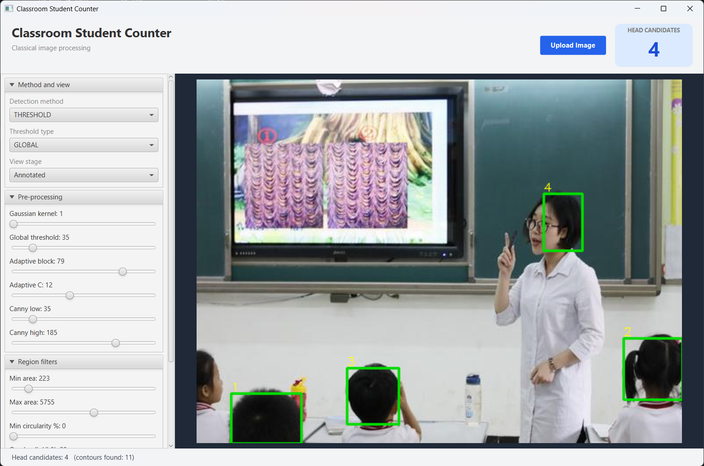
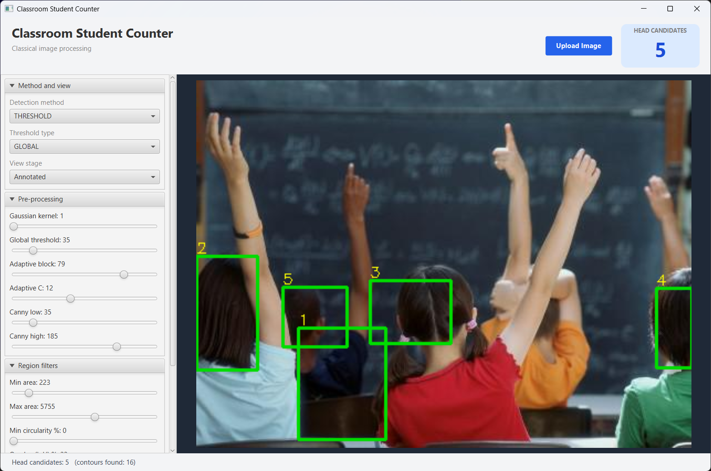

# Classroom Student Counter

[](https://github.com/Quack-Duck12/CSC360-GROUP9-ENDSEM/issues?q=is%3Aissue+state%3Aclosed)
[](https://github.com/Quack-Duck12/CSC360-GROUP9-ENDSEM/issues)

> Counts students in a classroom photo using classical image processing.

## Overview

A JavaFX app that loads a classroom image, runs it through an image-processing pipeline, and draws a box around each head candidate. Built from techniques in the course textbook (Burger & Burge, *Digital Image Processing*) using OpenCV.

<p align="center">
  
  
</p>

## Objectives

- Count head candidates using only textbook image-processing methods.
- Let the user see and adjust each pipeline stage.

## Installation

Requires JDK 17+ and Maven 3.9+. Dependencies (JavaFX, OpenCV) are downloaded by Maven.

```powershell
git clone https://github.com/Quack-Duck12/CSC360-GROUP9-ENDSEM.git
cd CSC360-GROUP9-ENDSEM
mvn verify
```

`mvn` compiles, runs all tests and builds the JavaDoc.

## Usage

```powershell
mvn javafx:run
```

1. Click **Upload Image**.
2. Choose a method and move the sliders.
3. Use **View stage** to see each step.
4. The count shows at the top right.

## Features

- Five detection methods: Threshold, Edges, Both, Hough, Blob
- Adjustable sliders for every step
- Stage viewer for intermediate images
- Live head count
- JUnit tests and JavaDoc

## Technologies Used

- Java 17
- JavaFX 21
- OpenCV 4.7
- Maven
- JUnit 5

## Project Structure

```text
CSC360-GROUP9-ENDSEM/
├── src/
│   ├── main/java/com/classcounter/
│   │   ├── Main.java                JavaFX window (sliders, stage viewer, count)
│   │   ├── vision/HeadDetector.java detection pipeline (5 methods)
│   │   ├── tools/ParamTuner.java    offline parameter search on SCUT-HEAD
│   │   └── util/NativeLoader.java   loads the OpenCV native library
│   └── test/java/com/classcounter/
│       ├── support/OpenCvTest.java  shared test setup
│       ├── vision/HeadDetectorTest.java   22 tests
│       └── tools/ParamTunerTest.java      20 tests
├── results/                         tuner logs and RESULTS.md (measured scores)
├── docs/                            architecture and process documents
├── pom.xml
└── README.md
```

## Tests

42 JUnit 5 tests cover the detector and the parameter tuner. Run them with `mvn test`.

## Results

Measured on 60 held-out SCUT-HEAD Part B images (details in [`results/RESULTS.md`](results/RESULTS.md)):

| Parameter set | F1 | Precision | Recall |
| --- | --- | --- | --- |
| Hand-picked starting values | 0.000 | 0.000 | 0.000 |
| Tuned, threshold method | 0.070 | 0.078 | 0.064 |
| **Tuned, final defaults** | **0.074** | **0.083** | **0.067** |

The detector counts dark, roughly round blobs of plausible size. It works better on sparse scenes than on crowded ones.

## Team Members

**CSC360 - Group 9**

| Name          | GitHub                                          | ID        |
| ------------- | ----------------------------------------------- | --------- |
| Jevis Maniyar | [Quack-Duck12](https://github.com/Quack-Duck12) | AU2520311 |
| Aryan Joshi   | [aryanjoshi15](https://github.com/aryanjoshi15) | AU2500017 |
| S. Kailash    | [kailash1557](https://github.com/kailash1557)   | AU2520033 |

## Textbook Map

| Topic | Textbook |
| --- | --- |
| Gaussian smoothing | Ch. 5.2 |
| Edge detection | Ch. 6.5 |
| Thresholding | Ch. 11.1, 11.2 |
| Morphology | Ch. 9.2, 9.3 |
| Region analysis | Ch. 10.1, 10.4 |

## Acknowledgements

We thank [HCIILAB](https://github.com/HCIILAB) for providing the [SCUT-HEAD Dataset](https://github.com/HCIILAB/SCUT-HEAD-Dataset-Release) used in this project.

- Burger, W. and Burge, M. J., *Digital Image Processing*, Springer, 2016.
